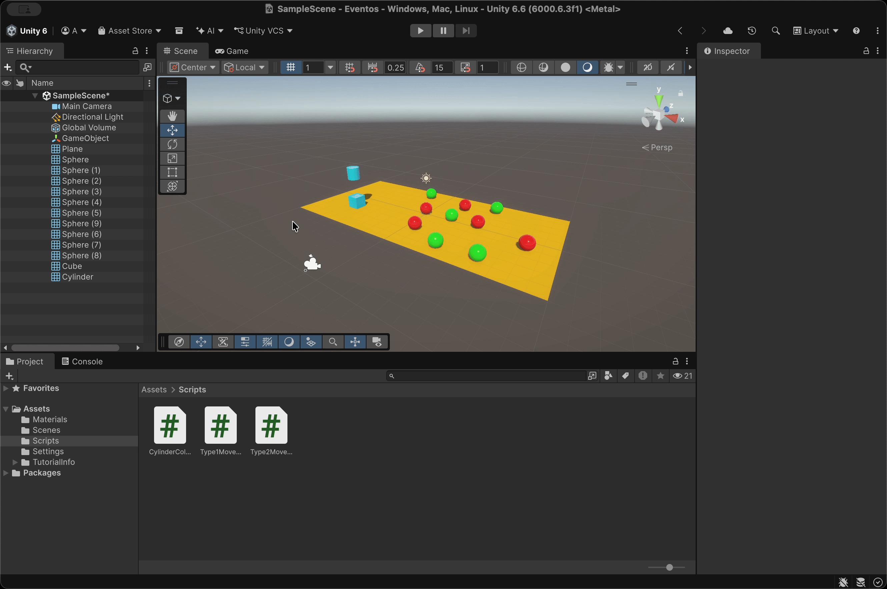
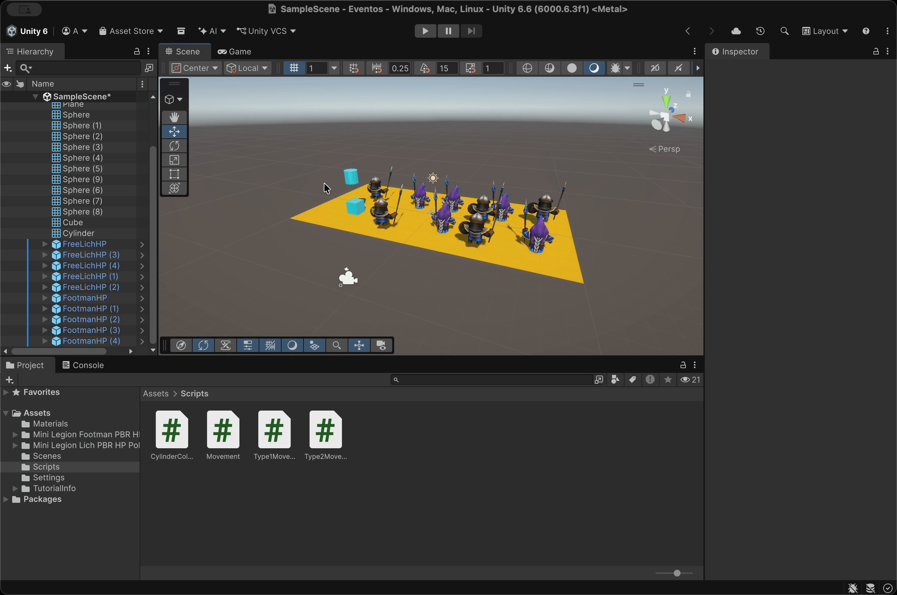
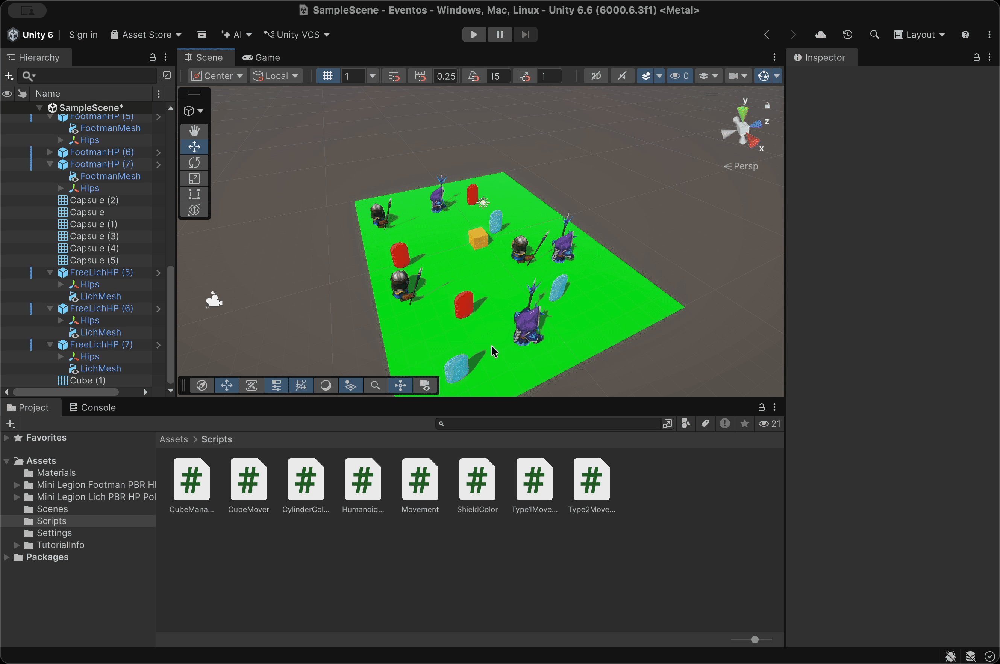
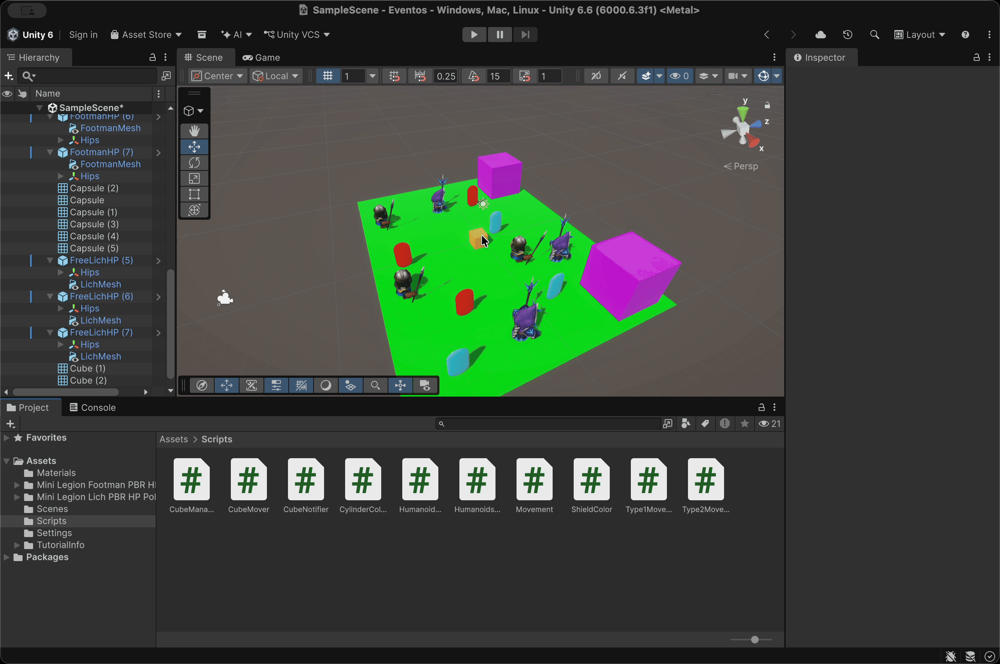
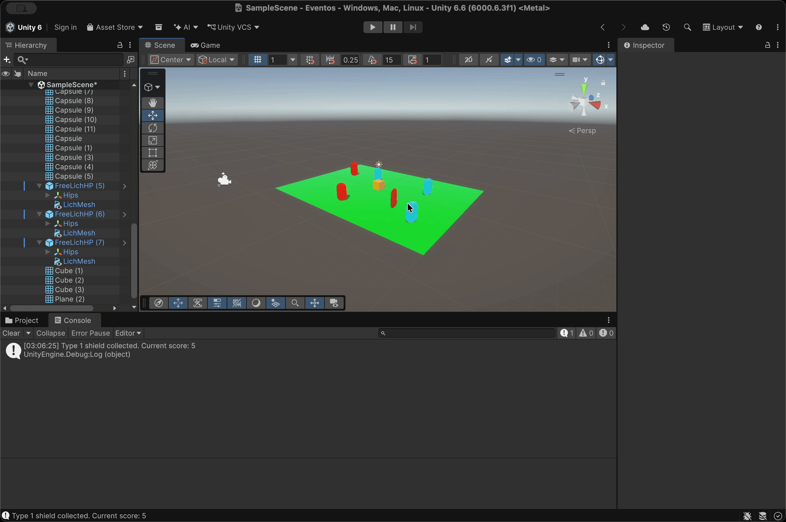
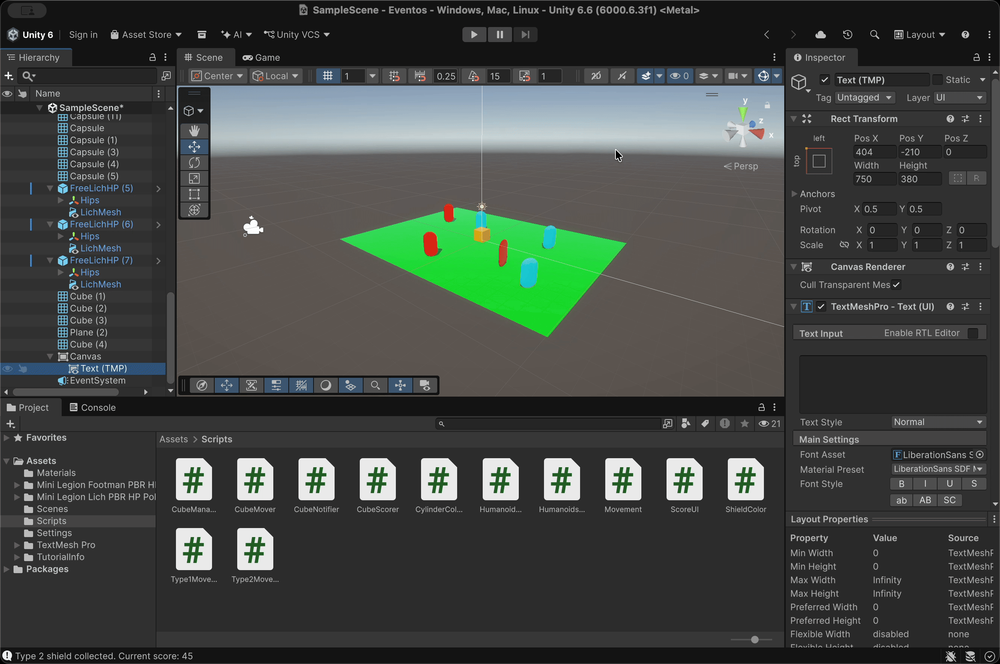
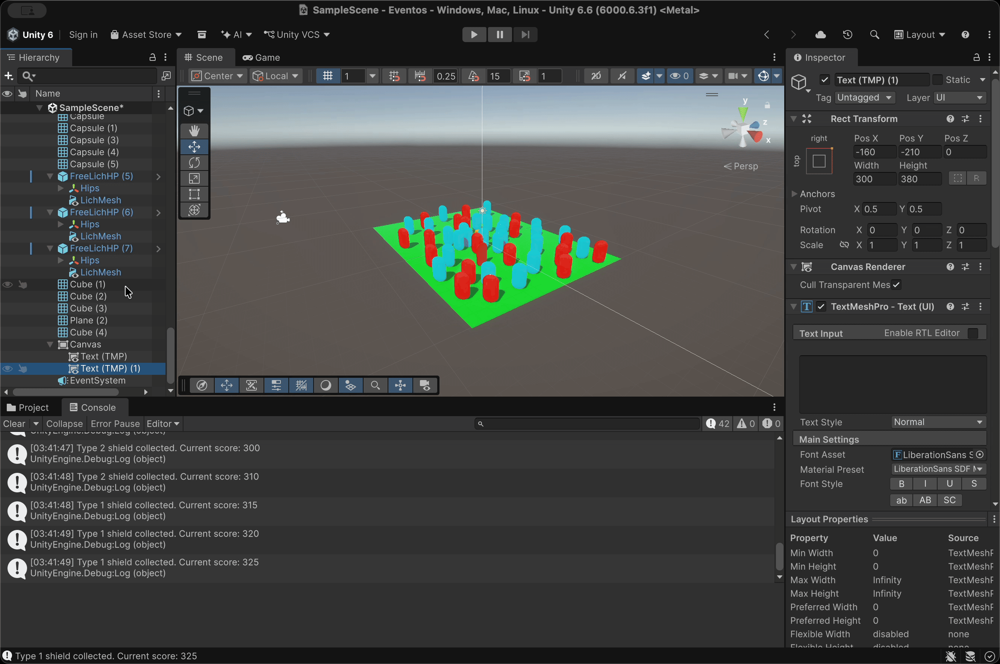

# Práctica 4 - Eventos y colisiones

**Asignatura:** Interfaces Inteligentes  
**Universidad:** Universidad de La Laguna  
**Titulación:** Grado en Ingeniería Informática  
**Curso:** 2026/2027  
**Fecha:** 23 de octubre de 2026

Repositorio con los scripts desarrollados para los ejercicios de eventos, colisiones e interfaz de usuario en Unity. Cada ejercicio tiene su propia carpeta de scripts, ya que algunos scripts se reutilizan y modifican de un ejercicio a otro. Cada ejercicio incluye una descripción de lo implementado, los hitos relevantes y una prueba de ejecución en GIF.

## Estructura del repositorio

```
.
├── gifs
│   ├── exercise_1.gif
│   ├── exercise_2.gif
│   ├── exercise_3.gif
│   ├── exercise_4.gif
│   ├── exercise_5.gif
│   ├── exercise_6.gif
│   ├── exercise_7.gif
│   ├── exercise_8.gif
│   └── exercise_9.gif
├── scripts
│   ├── exercise_1
│   │   ├── CylinderCollision.cs
│   │   ├── Type1Movement.cs
│   │   └── Type2Movement.cs
│   ├── exercise_2
│   │   ├── CylinderCollision.cs
│   │   └── Movement.cs
│   ├── exercise_3
│   │   ├── CubeManager.cs
│   │   ├── CubeMover.cs
│   │   ├── HumanoidMovement.cs
│   │   └── ShieldColor.cs
│   ├── exercise_4
│   │   ├── CubeMover.cs
│   │   ├── CubeNotifier.cs
│   │   └── HumanoidsReaction.cs
│   ├── exercise_5
│   │   ├── CubeMover.cs
│   │   └── CubeScorer.cs
│   ├── exercise_6
│   │   └── ScoreUI.cs
│   ├── exercise_7
│   │   └── ScoreUI.cs
│   ├── exercise_8
│   │   └── ScoreUI.cs
│   └── exercise_9
│       ├── CubeManager.cs
│       ├── CubeMover.cs
│       ├── HumanoidMovement.cs
│       └── ShieldColor.cs
└── readme.md
```

## Índice

1. [Ejercicio 1: Esferas que reaccionan a la colisión del cubo con el cilindro](#ejercicio-1)
2. [Ejercicio 2: Sustituir las esferas por humanoides](#ejercicio-2)
3. [Ejercicio 3: Humanoides y escudos de tipo 1 y tipo 2](#ejercicio-3)
4. [Ejercicio 4: Teletransporte y orientación al acercarse el cubo](#ejercicio-4)
5. [Ejercicio 5: Recolectar escudos y puntuación en consola](#ejercicio-5)
6. [Ejercicio 6: Mostrar la puntuación en la interfaz](#ejercicio-6)
7. [Ejercicio 7: Recompensa cada 100 puntos](#ejercicio-7)
8. [Ejercicio 8: Escena del prototipo](#ejercicio-8)
9. [Ejercicio 9: Ejercicio 3 con el cubo como objeto físico](#ejercicio-9)

<a id="ejercicio-1"></a>
## Ejercicio 1: Esferas que reaccionan a la colisión del cubo con el cilindro

**Scripts:** [`exercise_1/`](./scripts/exercise_1)

**Qué hace:** la escena contiene 5 esferas, rojas con la etiqueta `Type1` y verdes con la etiqueta `Type2`, un cubo y un cilindro. Cuando el cubo colisiona con el cilindro, las esferas de tipo 1 se dirigen hacia una esfera de tipo 2 fijada de antemano y las esferas de tipo 2 se desplazan hacia el cilindro.

**Hitos relevantes:**
- `CylinderCollision.cs` (en el cilindro) declara un delegado `CubeHitDelegate` y un evento estático `OnCubeHit`. En `OnCollisionEnter` comprueba si el objeto que ha chocado se llama `Cube` y, en ese caso, lanza el evento.
- Antes de invocar el evento se comprueba que no sea `null`, es decir, que haya al menos un suscriptor.
- `Type1Movement.cs` (en las esferas rojas) y `Type2Movement.cs` (en las esferas verdes) se suscriben al evento en `Start()` con `CylinderCollision.OnCubeHit += EnableMovement`. La función de callback activa el flag `canMove`.
- Una vez activado, en `Update()` cada esfera avanza hacia su objetivo con `Vector3.MoveTowards(transform.position, objetivo.position, moveSpeed * Time.deltaTime)`.
- El objetivo de cada grupo se asigna desde el inspector: `targetObject` (la esfera de tipo 2 elegida) en las de tipo 1 y `cylinder` en las de tipo 2.
- Para que se detecte la colisión, al menos uno de los dos objetos (cubo o cilindro) debe tener un `Rigidbody`.

**Prueba de ejecución:**



<a id="ejercicio-2"></a>
## Ejercicio 2: Sustituir las esferas por humanoides

**Scripts:** [`exercise_2/`](./scripts/exercise_2)

**Qué hace:** se sustituyen las esferas por humanoides, manteniendo la misma mecánica: al chocar el cubo con el cilindro, los humanoides de tipo 1 se dirigen hacia un humanoide de tipo 2 y los de tipo 2 hacia el cilindro.

**Hitos relevantes:**
- `CylinderCollision.cs` no cambia respecto al ejercicio anterior.
- Los dos scripts de movimiento se unifican en `Movement.cs`: como el comportamiento es el mismo y solo cambia el destino, cada humanoide tiene un `targetObject` asignado desde el inspector (un humanoide de tipo 2 para los de tipo 1, y el cilindro para los de tipo 2).
- Los humanoides tienen un `Rigidbody`, por lo que el movimiento pasa a `FixedUpdate()` y se hace con `rb.MovePosition(transform.position + transform.forward * moveSpeed * Time.fixedDeltaTime)`.
- Con `transform.LookAt(targetObject)` el humanoide se orienta hacia su objetivo y avanza en la dirección de su vector `forward`, de forma que camina mirando hacia donde va.

**Prueba de ejecución:**



<a id="ejercicio-3"></a>
## Ejercicio 3: Humanoides y escudos de tipo 1 y tipo 2

**Scripts:** [`exercise_3/`](./scripts/exercise_3)

**Qué hace:** en la escena hay humanoides y escudos de tipo 1 y de tipo 2. Cuando el cubo colisiona con un humanoide de tipo 2, los humanoides del grupo 1 se acercan a su escudo; cuando el cubo toca un humanoide del grupo 1, los del grupo 2 se dirigen hacia los escudos del grupo 2, que son objetos físicos. Si un humanoide colisiona con un escudo, este cambia de color.

**Hitos relevantes:**
- `CubeMover.cs` mueve el cubo en el plano XZ con `Input.GetAxisRaw("Horizontal")` y `Input.GetAxisRaw("Vertical")`, multiplicado por `moveSpeed` y `Time.deltaTime`.
- La detección de la colisión pasa del cilindro al cubo: `CubeManager.cs` declara dos eventos estáticos, `OnHitType1` y `OnHitType2`, y en `OnCollisionEnter` lanza uno u otro según la etiqueta del humanoide con el que ha chocado.
- `HumanoidMovement.cs` se suscribe a ambos eventos y decide en cada callback si debe reaccionar según su propia etiqueta: `ReactType2` (el cubo ha tocado un tipo 2) activa a los de tipo 1, y `ReactType1` (el cubo ha tocado un tipo 1) activa a los de tipo 2.
- Cada humanoide tiene asignado desde el inspector el escudo hacia el que debe ir (`shield`).
- Para que el humanoide no se incline, `LookAt` se hace hacia un punto con la `x` y la `z` del escudo pero la `y` del propio humanoide.
- Se fija `rb.sleepThreshold = 0f` para que el `Rigidbody` no entre en reposo mientras espera el evento y siga detectando colisiones.
- Las suscripciones se eliminan en `OnDestroy()` para evitar llamadas a objetos ya destruidos.
- `ShieldColor.cs` (en los escudos) cambia el color del material a rojo cuando colisiona con un objeto etiquetado como `Type1` o `Type2`.
- Se usan prefabs para generar los humanoides y escudos de cada grupo con las mismas características.

**Prueba de ejecución:**



<a id="ejercicio-4"></a>
## Ejercicio 4: Teletransporte y orientación al acercarse el cubo

**Scripts:** [`exercise_4/`](./scripts/exercise_4)

**Qué hace:** cuando el cubo se aproxima a un objeto de referencia, los humanoides del grupo 1 se teletransportan a un escudo objetivo fijado de antemano y los humanoides del grupo 2 se orientan hacia un objeto colocado en la escena con ese propósito.

**Hitos relevantes:**
- `CubeMover.cs` se mantiene igual que en el ejercicio anterior.
- `CubeNotifier.cs` (en el objeto de referencia) calcula en cada `Update()` la distancia al cubo con `Vector3.Distance` y, si es menor que 5 unidades, lanza el evento estático `OnCubeNear`.
- En este caso no hay colisión: la condición se basa en la proximidad entre objetos.
- `HumanoidsReaction.cs` se suscribe al evento y, según la etiqueta del humanoide:
  - `Type1`: se teletransporta asignando directamente `transform.position = targetObject.position`.
  - `Type2`: se orienta hacia el objetivo con `LookAt`, manteniendo su propia altura para no inclinarse.
- El `targetObject` de cada humanoide (el escudo objetivo o el objeto hacia el que orientarse) se asigna desde el inspector.

**Prueba de ejecución:**



<a id="ejercicio-5"></a>
## Ejercicio 5: Recolectar escudos y puntuación en consola

**Scripts:** [`exercise_5/`](./scripts/exercise_5)

**Qué hace:** el cubo recolecta los escudos de la escena. Los escudos de tipo 1 suman 5 puntos y los de tipo 2 suman 10. La puntuación se muestra en la consola.

**Hitos relevantes:**
- `CubeMover.cs` se mantiene igual para desplazar el cubo por la escena.
- `CubeScorer.cs` (en el cubo) usa `OnTriggerEnter`, por lo que los colliders de los escudos están marcados como *Is Trigger* y el cubo los atraviesa en lugar de chocar con ellos.
- El tipo de escudo se identifica con `other.CompareTag("Type1")` / `other.CompareTag("Type2")`.
- Tras sumar los puntos se muestra un mensaje con `Debug.Log` y el escudo se elimina con `Destroy(other.gameObject)`, para que no pueda recogerse dos veces.

**Prueba de ejecución:**



<a id="ejercicio-6"></a>
## Ejercicio 6: Mostrar la puntuación en la interfaz

**Scripts:** [`exercise_6/`](./scripts/exercise_6)

**Qué hace:** partiendo del ejercicio anterior, se crea una interfaz que muestra la puntuación que va obteniendo el cubo.

**Hitos relevantes:**
- La interfaz se construye con un `Canvas` que contiene un elemento de texto de TextMeshPro.
- `ScoreUI.cs` sustituye a `CubeScorer.cs`: mantiene la lógica de recolección con `OnTriggerEnter`, pero en lugar de escribir en la consola actualiza el texto de la UI.
- El texto se referencia desde el inspector mediante un campo público `TextMeshProUGUI scoreText`, y requiere `using TMPro;`.
- El método `UpdateText()` reescribe el texto con la puntuación actual; se llama en `Start()` para mostrar `Score: 0` desde el inicio y cada vez que se recoge un escudo.

**Prueba de ejecución:**



<a id="ejercicio-7"></a>
## Ejercicio 7: Recompensa cada 100 puntos

**Scripts:** [`exercise_7/`](./scripts/exercise_7)

**Qué hace:** amplía el ejercicio 6 para que cada 100 puntos el jugador obtenga una recompensa que se muestra en la UI.

**Hitos relevantes:**
- Se añade un segundo texto en el `Canvas`, referenciado con el campo `rewardText`.
- El número de recompensas se calcula con la división entera `score / rewardScore`, con la constante `rewardScore = 100`, de modo que se incrementa automáticamente cada vez que se supera un múltiplo de 100.
- El texto de recompensas solo se muestra a partir de la primera recompensa (`rewards > 0`).

**Prueba de ejecución:**



<a id="ejercicio-8"></a>
## Ejercicio 8: Escena del prototipo

**Scripts:** [`exercise_8/`](./scripts/exercise_8)

**Qué hace:** se genera una escena con elementos que se ajustan al prototipo, incorporando la mecánica de recolección de escudos, puntuación y recompensas de los ejercicios anteriores, y añadiendo una condición de victoria.

**Hitos relevantes:**
- `ScoreUI.cs` añade un tercer texto en el `Canvas` (`winningText`).
- Al alcanzar la puntuación objetivo, definida con la constante `winingScore = 500`, se muestra el mensaje `YOU WON!`.
- Se mantienen la puntuación y las recompensas del ejercicio 7.

**Prueba de ejecución:**


<a id="ejercicio-9"></a>
## Ejercicio 9: Ejercicio 3 con el cubo como objeto físico

**Scripts:** [`exercise_9/`](./scripts/exercise_9)

**Qué hace:** se repite el ejercicio 3, pero el cubo pasa a ser un objeto físico.

**Hitos relevantes:**
- Se añade un componente `Rigidbody` al cubo, de modo que pasa a estar gestionado por el motor de físicas.
- Las colisiones del cubo con los humanoides siguen detectándose en `CubeManager.cs` con `OnCollisionEnter`, y lanzan los mismos eventos que en el ejercicio 3.
- Al ser físico, el cubo responde a las colisiones: empuja a los humanoides y escudos con los que choca y puede ser desplazado por ellos.
- `HumanoidMovement.cs` y `ShieldColor.cs` mantienen el comportamiento del ejercicio 3.

**Prueba de ejecución:**


